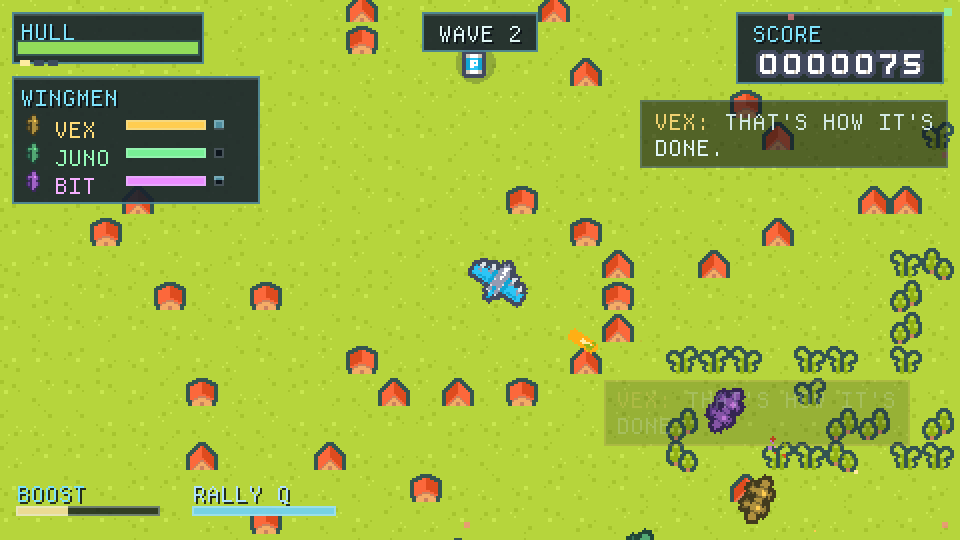

# Pixel Squadron

A small top-down twin-stick arena shooter written in C with
[raylib](https://www.raylib.com/). Fly a fighter over an endless procedural
archipelago, sink the enemy waves, grab the supply crates - and keep an eye on
your three wingmen, who chat, bicker and (usually) have your back.



## Play in the browser

<https://cflixdev-projects.github.io/pixel-squadron/>

## Features

- **Twin-stick combat** - move with WASD, aim with the mouse, fire with LMB.
  Gamepads (Xbox-style) are supported too.
- **Three AI wingmen** with distinct ships, names, personalities and special
  attacks. They escort you, call out threats, get perks from kills and
  respawn 15 seconds after going down. Every wave the wing is rearmed - more
  hull, harder-hitting rounds, quicker reloads - so they keep pace with a swarm
  that is getting nastier at the same time.
- **Recall** - press `Q` and the whole wing breaks off, sprints back and holds
  station until the danger has passed.
- **Squadron chatter** - speech bubbles pop up over whoever is talking, with a
  translucent message log down the right-hand side.
- **An endless procedural world** - the terrain is a pure function of the tile
  coordinate, so there is no map to reach the edge of and no two runs look
  alike. Fly in any direction for as long as you live.
- **Supply crates** dropped onto the islands at the top of every wave: better
  weapons, hull repairs and shields. They are marked on the screen edge when
  off screen, and a wingman will happily take one before you get there.
- **Critical hits** - one shot in five lands hard for 2.5x damage and flashes
  `CRIT` over the target.
- **Boost** - hold Shift to spend a rocket plume's worth of extra speed.
- **Wave-based survival** with a score, three weapon levels, rapid fire and
  shields.
- **Fills the screen** - the game renders into a pixel-perfect virtual screen
  whose zoom is always a whole number, then grows that screen until it covers
  the window. No letterbox bars, no cropping, no shimmer; a wider window simply
  shows more of the world.

## Controls

| Action | Keyboard / Mouse | Gamepad |
| --- | --- | --- |
| Move | `W` `A` `S` `D` / arrow keys | Left stick |
| Aim | Mouse | Right stick |
| Fire | `LMB` / `Space` | `RT` |
| Boost | `Shift` | - |
| Recall the wing | `Q` | `LB` / `D-pad down` |
| Pause | `P` / `Esc` | `Start` |
| Fullscreen | `F11` | - |
| Mute | `M` | - |
| Quit | `Esc` (from the pause or end screen) | - |

## Building (desktop)

Requires CMake 3.16+ and a C11 compiler. raylib 5.5 is fetched and built
automatically, or an installed copy is used if one is found.

```sh
cmake -S . -B build
cmake --build build -j
./build/pixel_squadron
```

Run from the repository root (or from `build/`, where a copy of `assets/` is
placed next to the binary) so the asset lookup can find what it needs.

### Command-line flags

| Flag | Effect |
| --- | --- |
| `--windowed` | Start in a window instead of fullscreen |
| `--fullscreen` | Force fullscreen |
| `--demo N` | Autopilot for `N` seconds, then exit (used for screenshots) |
| `--shot FILE` | Save a PNG screenshot when a `--demo` run finishes |
| `--endcard` | Dev aid: jump straight to the end-of-run report |
| `--seed N` | Use a fixed world seed |

## Building for the web

The game also builds to WebAssembly with the
[Emscripten SDK](https://emscripten.org/):

```sh
git clone https://github.com/emscripten-core/emsdk.git
cd emsdk && ./emsdk install latest && ./emsdk activate latest
source ./emsdk_env.sh          # or emsdk_env.bat on Windows

cd ..
emcmake cmake -S . -B build-web -DPLATFORM=Web
cmake --build build-web -j
```

The output lands in `build-web/`. Copy `index.html`, `*.js`, `*.wasm` and the
`.data` bundle into `docs/`, then commit and push `main`: GitHub Pages serves
that folder directly, so every push republishes the game.

## Credits

All art, sound and the UI font are free / open assets - see
[`assets/CREDITS.md`](assets/CREDITS.md) for the full list. raylib is zlib
licensed. The game's own code is MIT licensed (see [`LICENSE`](LICENSE)).
